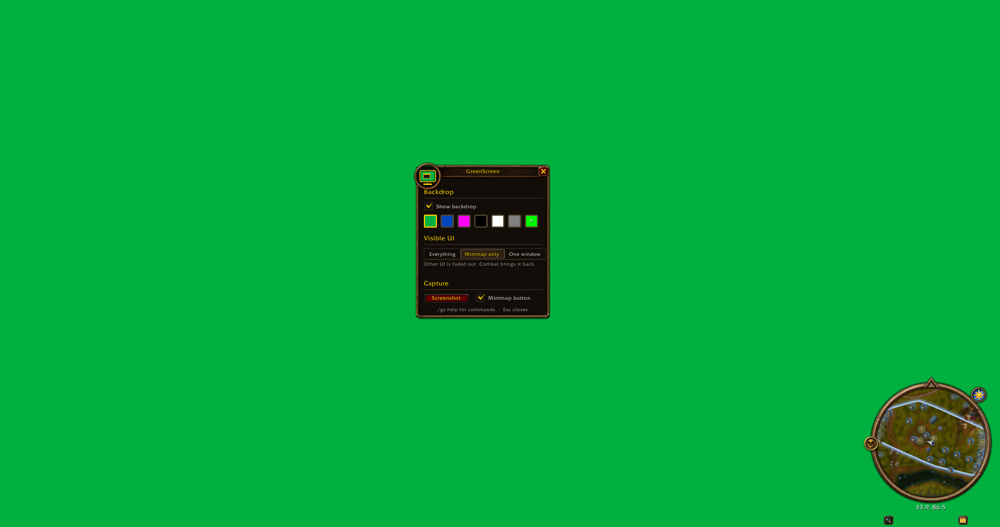

# GreenScreen

A WoW Forever addon for taking screenshots of addon windows. It puts a solid colour behind the UI so the 3D world disappears and only the interface is left on screen. Made for addon developers who want clean pictures of their windows for a project page or a bug report.

## What it does

The backdrop sits under every UI frame and over the game world. Clicks go through it, so you can still move the camera and click things. Pick a colour in the menu: chroma green, chroma blue, magenta, black, white, grey, or any custom colour. Black works best for windows with see-through backgrounds, since those blend with whatever is behind them.

The menu can also hide the rest of the UI:

- Everything shows all UI as normal.
- Minimap only fades out every other window and keeps the minimap with its buttons.
- One window draws a gold outline around the window under your mouse. Left-click one to keep only that window. Right-click cancels.

The Screenshot button hides the menu, takes the screenshot and brings the menu back. Entering combat always restores the full UI.

## How to use it

Left-click the minimap button to open the menu, or type `/gs`. Right-click the button to turn the backdrop on or off. The addon compartment entry works the same way.

| Command | What it does |
|---|---|
| `/gs` | Open the menu |
| `/gs bg` | Backdrop on or off (`/gs on`, `/gs off`) |
| `/gs green`, `blue`, `magenta`, `black`, `white`, `grey` | Set the colour |
| `/gs custom` | Colour picker. `/gs custom 255 128 0` sets exact values |
| `/gs next` | Next colour |
| `/gs minimap` | Minimap only (again for everything) |
| `/gs isolate` | Keep only the window under the mouse (again for everything) |
| `/gs all` | Show all UI again |
| `/gs shot` | Take a screenshot |

Every action can also go on a key under Options > Keybindings > AddOns > GreenScreen. A key is the easiest way to isolate a window: hover over it and press the key.

For lossless screenshots, run `/console screenshotFormat png` once.

## Notes

Nameplates and chat bubbles belong to the game world, so they can still show on top of the backdrop. Press V to hide nameplates. Hidden windows are made fully transparent, not closed, and a few of them (fading chat, action bar fade) may set their own transparency and come back. Windows that open after you switch modes show up as usual.

The minimap button joins LibDBIcon when another addon has loaded it, so button collectors can pick it up. GreenScreen ships no libraries of its own.

## License

MIT
